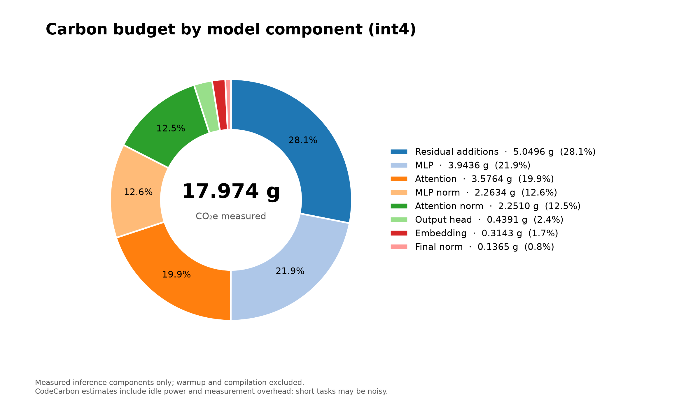

# Llama 3.2 in Jax 
**Why Llama 3.2?**
- According to Islam *et al.* (2025) Llama 3.2 achieves the most balanced trade-off between performance and energy efficiency. 
- Llama 3.2 is an open-weight model with a known architecture therefore allowing for weight-transfer. 

**Modifications**
- Implemented Flash Attention 
- Implemented 4bit matmul for quantisation to reduce memory overhead.
- KV-Cache for some speed up in terms of latency. 

**Weights**
- Weights come from the official [Llama 3.2 repo](https://huggingface.co/meta-llama/Llama-3.2-1B/tree/main)
- Along with the [tokeniser model](https://huggingface.co/meta-llama/Llama-3.2-1B/blob/main/original/tokenizer.model)

**Script**
- Install dependencies: `pip install -r requirements.txt` 
- Measuring latency and carbon intensity for all sections of the model.
- Run `python3 evaluate.py` after installing dependencies and the above weights. 
- Script will measure the accuracy and latency, and overall wattage draw. 
- `--component-carbon` flag will measure the carbon of each component. See *carbon counting* below.
- Profiling flags use the Jax profiler with python function calls filtered out.
- `generate.py` is an example generation script. 

**Dataset**
- A custom warehouse dataset created in a hybrid fashion.
- Dataset implemetation [here](https://github.com/MeRichard123/Dynamic_FEFO_Cold-Zone_Dispatch)
- Dataset is public on [HuggingFace](https://huggingface.co/datasets/RichardMe123/Dynamic_FEFO_Cold-Zone_Dispatch)
- Preliminary benchmarks and testing are work in progress

**Carbon Counting**

**Future**
- `lora.py` to train the model
- The rest of the quantised matmul kernels. 

