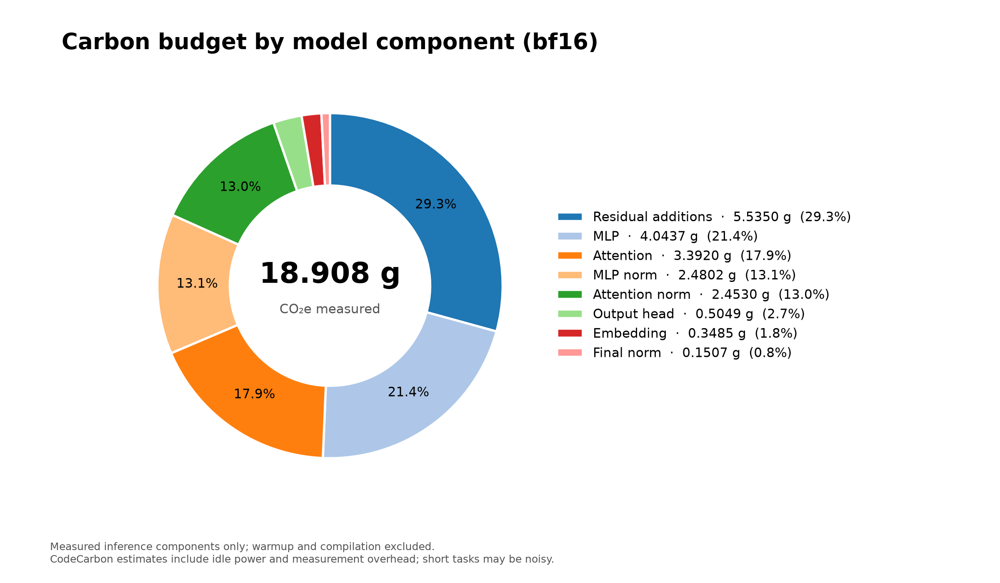

# Llama 3.2 in Jax 
**Why Llama 3.2?**
- According to Islam *et al.* (2025) Llama 3.2 achieves the most balanced trade-off between performance and energy efficiency. 
- Llama 3.2 is an open-weight model with a known architecture therefore allowing for weight-transfer. 

**Modifications**
- Implemented Flash Attention.
- Implemented 4bit matmul for quantisation.

**Weights**
- Weights come from the official [Llama 3.2 repo](https://huggingface.co/meta-llama/Llama-3.2-1B/tree/main)
- Along with the [tokeniser model](https://huggingface.co/meta-llama/Llama-3.2-1B/blob/main/original/tokenizer.model)

**Script**
- Measuring latency and carbon intensity for all sections of the model.

**Dataset**
- https://huggingface.co/datasets/RichardMe123/Dynamic_FEFO_Cold-Zone_Dispatch

**Carbon Counting**

